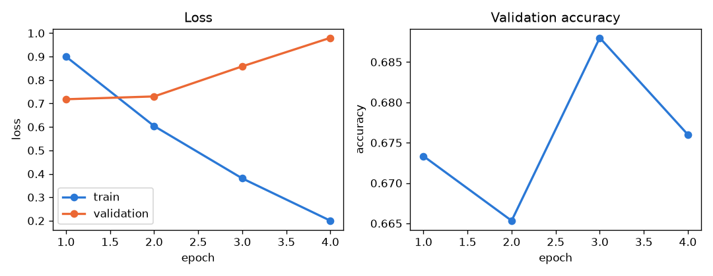
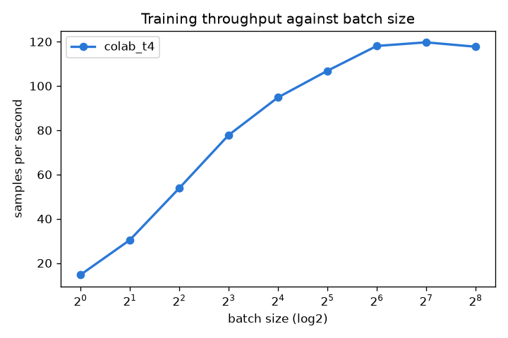
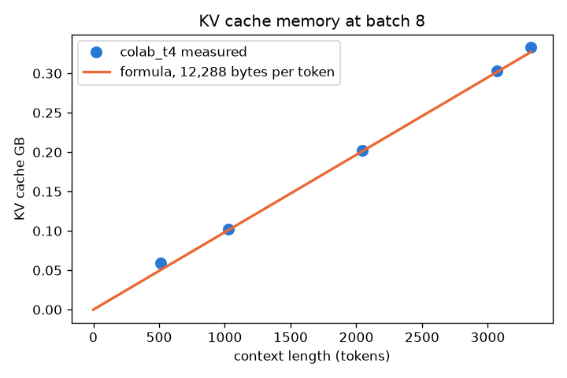

# METRICS, HW4.a and HW4.5

SJSU ID 018205330, SID4 5330, SEED 5330, SLICE 330.

Cards: **colab_t4** Tesla T4, 15.6 GB. UUID GPU-e98b1f84-8d7b-50bb-a5c6-96b3440c7e56: hw4a, part_d_kv, serve_hf_hw4, serve_vllm_hw4, serve_vllm_partd; UUID GPU-72d7994b-bdfd-5779-ea43-fbfd70d47b68: part_a, part_b, part_b_probes

## HW4.a BERT fine tune on colab_t4

Dataset cardiffnlp/tweet_eval (sentiment, train split). Rows 330 to 5329 of 45615 (5000 rows). Split 70/15/15 with SEED 5330: train 3500, validation 750, test 750. Settings: {'model': 'bert-base-uncased', 'max_len': 64, 'batch': 32, 'lr': 2e-05, 'epochs': 4, 'seed': 5330}.

| Epoch | Train loss | Val loss | Val acc | Epoch s |
|---|---|---|---|---|
| 1 | 0.9001 | 0.7182 | 0.6733 | 37.4 |
| 2 | 0.6037 | 0.7301 | 0.6653 | 38.5 |
| 3 | 0.3806 | 0.8584 | 0.6880 | 40.6 |
| 4 | 0.2001 | 0.9802 | 0.6760 | 43.6 |

Validation loss stopped improving after epoch 1. Training 3 more epochs cost 122.8 s and moved validation loss from 0.7182 to 0.9802 (accuracy 0.6733 to 0.6760).

Validation accuracy peaked at epoch 3 (0.6880), later than validation loss. The saved model and all test numbers below come from the final epoch 4 model.

Test accuracy after save and reload: 0.6587. **Peak GPU memory 2.65 GB, training wall clock 160.2 s** (HW4.5 baseline only).

Confusion matrix (rows true, columns predicted):

|  | negative | neutral | positive |
|---|---|---|---|
| negative | 72 | 32 | 12 |
| neutral | 32 | 231 | 80 |
| positive | 11 | 89 | 191 |

| Class | Precision | Recall | F1 | Support |
|---|---|---|---|---|
| negative | 0.626 | 0.621 | 0.623 | 116 |
| neutral | 0.656 | 0.673 | 0.665 | 343 |
| positive | 0.675 | 0.656 | 0.666 | 291 |

Worst class (lowest F1): **negative**. Five misclassified examples, diagnosis in ANALYSIS.md:

| # | Tweet | Predicted |
|---|---|---|
| 1 | @user She's invited. And Ash may not go because of her. And I want Ash to be there because his AE helped mine through some stuff.. (sic: the apostrophe is stored escaped in the dataset) | neutral |
| 2 | You may remember Frank Gifford as a great football player or broadcaster. But I remember him as the guy who wanted anal from a stewardess | neutral |
| 3 | "It's simple, we want to be like Israel, a white Israel.  If that's a bad thing, so is current Israel. | neutral |
| 4 | Please pull down Tom Brady's pants and undress the cheaters on Thursday night @user | neutral |
| 5 | "Kane may have made it 5-0, I may have lost my bet. But guess what, I can speak properly, Harry Kane can't." | neutral |

| Custom input | Prediction |
|---|---|
| I love how fast this new phone charges! | positive |
| Traffic again. Worst commute ever. | negative |
| The meeting is moved to 3pm on Thursday. | neutral |

### Table HW4.1, serving comparison on colab_t4

Model `Qwen/Qwen2.5-0.5B-Instruct`, fp16, 128 new tokens per request, greedy. Prompt: "Explain why the sky is blue to a ten year old."

| Configuration | Tokens/sec | p50 latency (ms) | p95 latency (ms) |
|---|---|---|---|
| HF pipeline, batch 1 | 25.1 | 5009.4 | 5657.7 |
| vLLM, batch 1 | 172.0 | 743.0 | 752.2 |
| vLLM, batch 8 | 1246.7 | 820.8 | 826.5 |
| vLLM, batch 32 | 3552.8 | 1152.8 | 1153.7 |

Sample output: To a ten-year-old, the sky being blue is a fascinating and awe-inspiring phenomenon. Here are some reasons why the sky appears blue to a child:  1. **Color Mixing**: The sky is made up of various colors, including blue, green, and white. When light passes through the atmosphere, it is refracted and scattered, causing the colors to mix and blend together. The blue light from the sun is the most dom

Method: latency is the time for the whole batch call to finish, every request generates exactly 128 tokens (ignore_eos), and time to first token is not measured. The 8 prompts repeat inside the batch 8 and 32 runs, so vLLM prefix caching may help those slightly.

## HW4.5 Part A, batch scaling to the memory wall

**colab_t4**: largest batch 256, first OOM at 512. Throughput stops improving (within 5% of best) at batch 64.

| Batch | Samples/s | Peak GB | Epoch s |
|---|---|---|---|
| 1 | 14.7 | 2.21 | 238.7 |
| 2 | 30.4 | 2.22 | 115.1 |
| 4 | 53.8 | 2.22 | 65.1 |
| 8 | 77.8 | 2.22 | 45.0 |
| 16 | 94.8 | 2.24 | 36.9 |
| 32 | 106.8 | 2.66 | 32.8 |
| 64 | 118.1 | 4.00 | 29.6 |
| 128 | 119.7 | 6.53 | 29.2 |
| 256 | 117.7 | 11.71 | 29.7 |
| 512 | OOM |  |  |

Method: each row is timed over 5 steps after 2 warmup steps on randomly sampled batches, and Epoch s is extrapolated as 3500 / samples per second, not measured. These short timings are optimistic: at batch 32 they give 106.8 samples/s and 32.8 s per epoch, while the sustained Part B baseline ran at 91.9 samples/s (about 14% lower) and the measured HW4.a epochs took 37 to 44 s.

Only one card was used (the TA confirmed one GPU is enough), so the max batch ratio between two cards is not measured. ANALYSIS.md gives a worked projection instead.

## HW4.5 Part B, memory techniques one at a time

### Table HW4.5.1 on colab_t4 (AMP dtype torch.float16)

| Technique | Max batch | Throughput (samp/s) | Peak memory (GB) | Eval accuracy | Wall s | Notes |
|---|---|---|---|---|---|---|
| Baseline (HW4 settings) | 256 | 91.9 | 2.65 | 0.6480 | 151.8 | AdamW, effective batch 32, 436 optimiser steps |
| Mixed precision | 512 | 260.9 | 2.40 | 0.6480 | 53.5 | AdamW, effective batch 32, 436 optimiser steps |
| Gradient checkpointing | 1024 | 66.1 | 2.22 | 0.6480 | 211.2 | AdamW, effective batch 32, 436 optimiser steps |
| Gradient accumulation | n/a | 90.1 | 2.47 | 0.6333 | 619.7 | AdamW, effective batch 128, 436 optimiser steps |
| 8-bit optimiser | 256 | 89.8 | 2.01 | 0.6573 | 155.3 | AdamW8bit, effective batch 32, 436 optimiser steps |
| Best combination | 512 | 263.8 | 1.74 | 0.6520 | 52.9 | AdamW8bit, effective batch 32, 436 optimiser steps |

Gradient accumulation has no max batch of its own: per step memory is set by the physical batch of 16, so it is marked n/a. Its run trained 436 optimiser steps x 128 samples = 55,808 samples, about 16 epochs over 3500 rows. The training loop also dropped the last 2 of the 218 micro batches in each epoch (218 is not a multiple of 8).

Ranking at the training batch of 32 (peak GB saved per samples/s lost):

| Rank | Technique | GB saved | Samples/s lost | GB saved per samp/s lost |
|---|---|---|---|---|
| 1 | Mixed precision | 0.251 | -169.0 | no throughput lost |
| 2 | 8-bit optimiser | 0.641 | 2.1 | 0.3037 |
| 3 | Gradient accumulation | 0.180 | 1.9 | 0.0958 |
| 4 | Gradient checkpointing | 0.433 | 25.9 | 0.0168 |

Same techniques at batch 256, from the max batch probe runs (5 timed steps each, so throughput is optimistic):

| Batch 256 | Peak GB | Samples/s |
|---|---|---|
| Baseline | 11.71 | 117.7 |
| Mixed precision | 8.21 | 394.7 |
| Gradient checkpointing | 3.05 | 70.8 |
| 8-bit optimiser | 11.05 | 97.4 |
| Best combination | 7.55 | 406.7 |

Ranking at batch 256 (accumulation has no batch 256 run):

| Rank | Technique | GB saved | Samples/s lost | GB saved per samp/s lost |
|---|---|---|---|---|
| 1 | Mixed precision | 3.50 | -277.0 | no throughput lost |
| 2 | Gradient checkpointing | 8.66 | 46.9 | 0.185 |
| 3 | 8-bit optimiser | 0.66 | 20.4 | 0.032 |

The ranking depends on batch size. At batch 32 activations are small, so checkpointing saves little and ranks last. At batch 256 activations dominate, so checkpointing saves 8.7 GB and ranks above the 8 bit optimiser.

## HW4.5 Part C, distributed data parallel

Part C skipped (optional).

## HW4.5 Part D, serving revisited

**colab_t4**, vLLM rerun:

| Configuration | Tokens/sec | p50 latency (ms) | p95 latency (ms) |
|---|---|---|---|
| vLLM, batch 1 | 164.9 | 777.7 | 781.0 |
| vLLM, batch 8 | 1202.5 | 850.8 | 855.9 |
| vLLM, batch 32 | 3323.9 | 1233.5 | 1246.1 |

Same card type, same fp16 precision and same script as HW4, 4% to 7% slower. That size of gap is run to run variation (host CPU load and GPU clocks), not a change in hardware or precision.

**colab_t4** KV cache at batch 8 (`Qwen/Qwen2.5-0.5B-Instruct`, 12288 bytes per token, native max position 32768). Longest context measured with HF prefill: **3328** (fails at 3584). The KV cache is only a small part of the peak: memory runs out on the attention scores, which grow with the square of the context.

vLLM capacity at batch 8 is **calculated, not tested**: both vLLM runs used max_model_len 2048, and that engine logged a KV pool of 9.9 GiB = 865,456 tokens on this T4. 865,456 / 8 = 108,182 tokens per sequence, so the KV pool alone would cover the model's native maximum of 32768 at batch 8. A run with max_model_len 32768 and 8 long prompts would be needed to confirm it.

| Context | KV measured GB | KV formula GB | Peak GB |
|---|---|---|---|
| 512 | 0.059 | 0.050 | 1.41 |
| 1024 | 0.103 | 0.101 | 2.35 |
| 2048 | 0.202 | 0.201 | 5.82 |
| 3072 | 0.303 | 0.302 | 11.41 |
| 3328 | 0.333 | 0.327 | 13.15 |
| 3584 | OOM |  |  |
| 4096 | OOM |  |  |

## HW4.5 Part E, GPU hours and summary

**colab_t4**: full fine tune = 70% of 45615 tweets x 4 epochs = 127720 training samples.

| Configuration | Samples/s | 4 epochs, GPU hours | 1 epoch, GPU hours |
|---|---|---|---|
| Baseline (HW4 settings) | 91.9 | 0.386 | 0.096 |
| Mixed precision | 260.9 | 0.136 | 0.034 |
| Gradient checkpointing | 66.1 | 0.537 | 0.134 |
| Gradient accumulation | 90.1 | 0.394 | 0.098 |
| 8-bit optimiser | 89.8 | 0.395 | 0.099 |
| Best combination | 263.8 | 0.135 | 0.034 |

GPU hours = samples / (samples per second x 3600). Validation loss stopped improving after epoch 1, so the 1 epoch column is the realistic cost.

### HW4.5 summary on colab_t4

This is the HW4.5 summary only. It is not an HW5 baseline.

| Best | Configuration | Value |
|---|---|---|
| Peak memory | Best combination | 1.74 GB |
| Throughput | Best combination | 263.8 samples/s |
| Wall clock | Best combination | 52.9 s for 436 optimiser steps |
